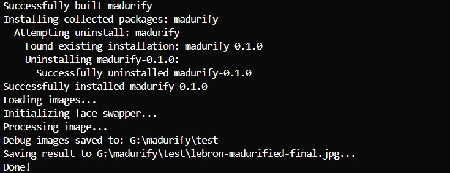
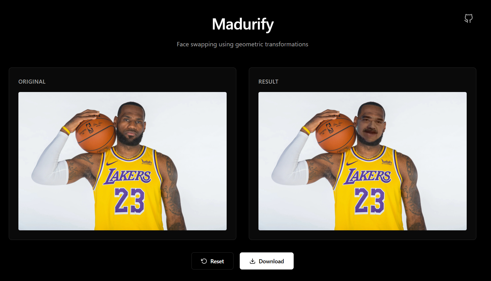

# Madurify

A Python application with CLI and web interfaces that lets you swap faces in images without using AI!

## Features

- Face detection using dlib
- Accurate face region masking with full jaw contour coverage
- Multi-source face template selection for best match
- Color correction in LAB color space
- Adaptive local lighting transfer for mixed lighting and face shadows
- Poisson and multi-band blending
- Glasses and mouth interior restoration
- Video and real-time webcam face swapping with temporal smoothing
- Web interface with drag-and-drop upload
- Web uploads support JPG, PNG, GIF, and WebP images, plus common video formats

## Requirements

- Python 3.11+

## Installation

1. Clone the repository:
```bash
git clone https://github.com/iakzs/madurify.git
cd madurify
```

2. Install dependencies, setup the application:

Quick install & setup (if CMake is installed):
```bash
pip install -r requirements.txt && pip install -e .
```



## Usage

### CLI

Process a single image:
```bash
madurify input.jpg -o output.jpg
```

Or use Python directly:
```bash
python -m src.cli.main input.jpg -o output.jpg
```

Images can be JPG, PNG, GIF, or WebP. Phone photos keep their orientation.

Options:
- `-o, --output`: Output file path (default: `input_madurified.jpg`)
- `-m, --maduro-face`: Path to face templates (can be more than one) (default: `assets/maduro_face*.jpg`)
- `-p, --predictor`: Path to dlib predictor (default: `models/shape_predictor_68_face_landmarks.dat`)
- `-d, --debug`: Save intermediate processing images
- `--suffix`: Output filename suffix in batch mode (default: `_madurified`)
- `--format`: Output format for batch mode (`jpg`, `png`, or `webp`; default: same as input). Animated GIF and WebP files keep their own format.
- `--scale`: Detection size in video and webcam mode (default: `0.6`; `1.0` uses full resolution)
- `--detect-every`: Re-detect faces every N frames in video and webcam mode (default: `2`)
- `--max-edge`: Longest side processed in video and webcam mode (default: `1280`; `0` keeps full resolution). The saved video stays at the original size.

### Video

Process a video file:
```bash
madurify input.mp4 -o output.mp4
```

When ffmpeg is installed, the result is H.264. ffmpeg also keeps the original audio and writes the file so it plays in the browser. Without ffmpeg, the video is still saved and the audio is left out.

### Webcam

Real-time webcam face swap:
```bash
madurify --cam
```

Controls: `q`/`ESC` quit, `s` snapshot, `f` toggle mirror.

### Web Interface

Start the web server:
```bash
uvicorn src.web.app:app --reload
```

Then open your browser to `http://localhost:8000`

Web uploads accept JPG, PNG, GIF, and WebP, plus MP4, MOV, MKV, WEBM, AVI, and M4V. Images are limited to 20 MB and videos to 200 MB. Animated GIF and WebP files stay animated.

The Speed control (Fast, Balanced, High) applies to video and animated images. High uses a larger frame and detects faces more often. A single photo always uses the full-quality blend. The same ffmpeg requirement as the CLI applies to browser playback and audio.



## Warning

The developer and contributors do not contribute to this application for hate purposes. This repository is intended for educational purposes only.

## License

See LICENSE file for details.
